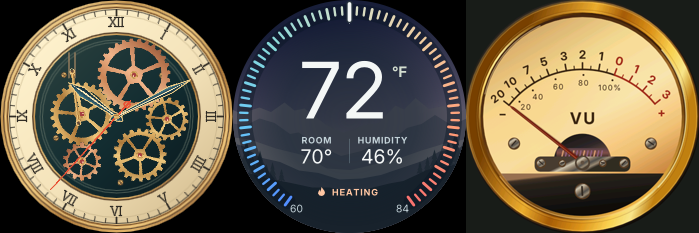

# Rive demos for a round AMOLED

Five working firmware examples for the **Waveshare ESP32-S3-Touch-AMOLED-1.43 (non-C)**. Flash the pocket watch to see an RTC-driven instrument, or use the live player to try your own `.riv` file. The other examples show how cached Rive graphics and procedural drawing perform on the same panel.

The demos pin two independent packages as Git submodules. **rive-framebuffer** loads and renders Rive files. **waveshare-round-amoled** drives the display, touch controller and accelerometer. The standalone **riv-render** desktop tool is distributed in its own repository. [Renderer](deps/rive-framebuffer) · [Board drivers](deps/waveshare-round-amoled)

## Examples



| Example | What it does |
| --- | --- |
| [Pocket watch](examples/pocket-watch/main/main.c) | Tells time from the board clock. The seconds hand sweeps, five gears drive a crank, and a tap opens or closes the tilt-lit brass cover. |
| [Rive player](examples/rive-player/main/main.c) | Plays your embedded `.riv`. The bundled `Movement` artboard animates the gear train and has fixed hand positions. Forwards touch to the artboard and transfers only changed regions after the first frame. |
| [Thermostat](examples/thermostat/main/main.c) | Touch the rim to change the setpoint. At startup the firmware renders the Rive view model at each setting, then releases the runtime. A drag blends two cached landscapes and draws the selected indicators. |
| [Baked VU meter](examples/baked-meter/main/main.c) | Replays an eight-second Rive animation at native panel resolution. Firmware restores the old needle pixels and applies the current pose from flash. |
| [Tilt water](examples/tilt-water/main/main.c) | Tilt the board and the water follows gravity. Two cores shade alternating groups of rows directly into the display’s DMA buffers. |

## Run the board examples

Activate an ESP-IDF **5.3.2** environment for ESP32-S3. The examples configure a 466 × 466 QSPI panel, octal PSRAM and a 16 MiB flash layout. From the demo checkout, initialize the board dependency and install its vendor files and flash the standalone clock. Replace `PORT` with the board’s serial port. Flashing installs the example and its partition table. Use Ctrl+] to leave the monitor.

```sh
git submodule update --init deps/waveshare-round-amoled
python3 deps/waveshare-round-amoled/tools/setup-board.py
idf.py -C examples/pocket-watch -p PORT flash monitor
```

The watch opens its lid on boot. Tap to close or reopen it. Tilt the closed lid to move the brass reflection. At startup the firmware reads the PCF85063 clock and logs the time source. If the RTC needs initialization, it seeds it from the firmware build time. When the RTC is unavailable, it advances from build time using the ESP timer.

The dial, lid, gears and hands come from three cached Rive artboards. The firmware rotates each hand to its angle for the current time, animates the wheel train and sends rectangles containing changed pixels to the display. On one ESP32-S3 board the open clock measured 25.0 FPS (126 completed updates in 5.04 seconds). On the same board, playing the entire vector `Movement` artboard measured 5.4 FPS, with 161 ms per changed frame spent rasterizing. Both measurements use a 233 × 233 framebuffer on the 466 × 466 panel. [Watch renderer](examples/pocket-watch/main/watch.c)

The setup script checks the Waveshare V3 ZIP against its SHA-256 digest before installing the required files. If you already have the ZIP, pass its path to `deps/waveshare-round-amoled/tools/setup-board.py`. ESP-IDF resolves the pinned Espressif components during configuration.

### Play a .riv file on the board

The live player and thermostat also need the renderer submodules.

```sh
git submodule update --init --recursive deps/rive-framebuffer
```

To play your own file, supply its absolute path. Omit `RIV_ARTBOARD` on a fresh build to use the file’s default artboard, or set it to a name. The bundled watch uses `Movement`.

```sh
idf.py -C examples/rive-player -DRIV_FILE="/absolute/path/to/your.riv" -DRIV_ARTBOARD="" build
```

ESP-IDF caches those settings. To return to the bundled gear animation, build with `-DRIV_FILE="" -DRIV_ARTBOARD=""`. Flash the player with the same port used above.

```sh
idf.py -C examples/rive-player -p PORT flash monitor
```

Use `examples/thermostat`, `examples/baked-meter` or `examples/tilt-water` in the same commands to build and flash those projects. The pocket watch, meter and water projects build with just ESP-IDF and the Waveshare setup. Run `tools/build-firmware` to compile all five projects.

## Edit the artwork

The watch, thermostat and meter include editable Rive CLI projects under [assets](assets/). The checked-in exports and baked files are ready to build. To regenerate the source from its drawing parameters, use Python 3.9 or later. The two instruments with outlined Inter labels also use the `fonttools` package and the recursive Rive submodule.

```sh
python3 tools/build_watch_art.py
python3 tools/build_thermostat_art.py
python3 tools/build_vu_meter_art.py
python3 tools/build_water_art.py
```

The standalone clock’s [Rive project](assets/pocket-watch/scene.rml) holds the dial, hunter cover and a 466 × 466 tray of movable parts. After editing those artboards, run `python3 tools/bake_watch.py --rive rive` with the Rive CLI and FFmpeg installed. This recreates the three compressed ARGB layers embedded in the firmware. The [part definitions](assets/watch/parts.def) give the tray pivots, hand lengths and wheel gearing.

After changing the live player’s watch or thermostat RML, use the Rive CLI’s local export to replace its adjacent `.riv`. Local export requires a signed-in Rive CLI. For the VU meter, the bake tool uses the CLI’s headless capture mode and FFmpeg to convert the frames to RGB565 patches.

```sh
rive assets/watch --publish=local --output-dir=.
rive assets/thermostat --publish=local --output-dir=.
python3 tools/bake_meter.py --rive rive
```

The meter bake was verified with Rive CLI 1.9.2.

The VU file contains a base frame, a little-endian table of 201 byte offsets and 200 sets of pixel replacements. Each replacement stores a 16-bit position in the needle rectangle and a 16-bit color. Every pose refers to the base frame so playback can skip directly to the current time. [Encoder](tools/bake_meter.py) · [Decoder](examples/baked-meter/main/vu_meter.c)

## Test the demo code on a computer

Use CMake 3.20+, a C/C++17 compiler, the Unix `patch` utility and zlib development headers. The host fixtures cover the pocket watch, water, VU meter and thermostat. Configure with `-DWITH_RIVE=OFF` for the three examples that only need the board package.

```sh
git submodule update --init --recursive
cmake -S . -B build -DCMAKE_BUILD_TYPE=Release
cmake --build build --parallel
ctest --test-dir build --output-on-failure
```

Original demo code and artwork use the MIT license. [License](LICENSE) · [Third-party sources](THIRD_PARTY.md)
